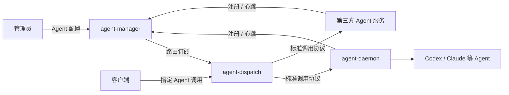

# Agent Hub

使用 Go 构建的 AI Agent 注册、管理、配置与调用平台。

Agent Hub 为不同 AI Agent 提供统一入口：服务注册后，管理员配置 Agent 的能力描述与服务绑定，客户端即可选择 Agent 发起对话和任务执行。

> 当前阶段：架构设计。仓库尚无 Go 模块或可运行程序；具体调用协议、后端接入方式和运行参数将在后续设计。

## 核心能力

- **服务注册与发现**：管理 Agent 服务实例、在线状态和租约。
- **Agent 管理与配置**：维护 Agent ID、能力描述、服务绑定及启用状态。
- **统一调用入口**：客户端指定 Agent，平台完成路由、会话绑定和调用转发。
- **现成 Agent 封装**：通过 Daemon 内部适配器，将 Codex、Claude 等 Agent 包装成服务。
- **第三方服务接入**：其他 Agent 服务可直接实现标准协议，将自身能力接入平台。

以上为首版建设方向，完整范围见[首版范围与实施计划](docs/roadmap.md)。

## 架构概览

平台包含三个独立程序：

| 程序 | 职责 |
| --- | --- |
| `agent-manager` | 管理服务注册、实例租约、Agent 定义与能力配置，发布路由信息 |
| `agent-dispatch` | 订阅路由，接受客户端调用，维护平台会话和实例绑定，转发请求与执行事件 |
| `agent-daemon` | 作为 Agent 服务实例，封装现成 Agent，管理原生会话、执行过程和工作区 |

Daemon 是标准协议的一种服务实现，直接接受 Dispatch 调用。第三方服务无需部署 Daemon，也可以通过相同协议接入。

基本路由关系为 `agent-id → agent-service-name → 服务实例`。首版会话绑定执行实例，平台聊天记录、原生 Agent 会话和工作区分别管理。详细职责和故障边界见[架构设计](docs/architecture.md)。

## 文档

- [文档导航](docs/README.md)：阅读顺序与文档维护约定。
- [架构设计](docs/architecture.md)：组件职责、核心概念、主要流程与状态归属。
- [首版范围与实施计划](docs/roadmap.md)：功能边界、实施阶段与验收方向。
- [标准协议设计范围](docs/protocol-design.md)：后续协议设计议题，具体协议尚未制定。
- [贡献指南](AGENTS.md)：项目组织、开发风格、测试与提交约定。

## 仓库组织

- `README.md`：项目介绍与架构概览。
- `docs/`：详细设计与实施规划。
- `AGENTS.md`：贡献指南。
- `LICENSE`：许可证。

计划在 `cmd/agent-manager/`、`cmd/agent-dispatch/` 和 `cmd/agent-daemon/` 下组织程序入口；这些目录目前尚未创建。构建和启动说明将在实现可运行程序后补充。
