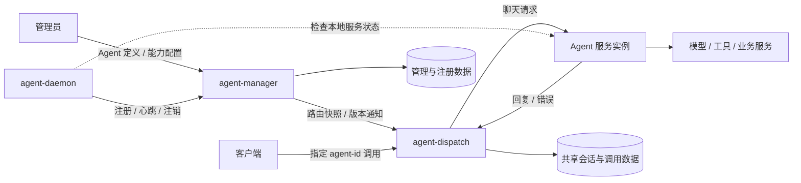

# Agent Hub

使用 Go 构建的 AI Agent 注册、管理、配置与对话平台。

首版由三个独立程序组成：`agent-daemon` 注册和维护 Agent 服务实例；`agent-manager` 管理服务、Agent 定义与能力配置；`agent-dispatch` 订阅路由信息，接受客户端调用并转发到可用实例。

> 当前阶段：需求与架构设计。三个程序的职责划分作为首版架构基础；本文中的具体接口、字段、订阅协议与运行参数仍为设计草案。仓库尚未包含服务实现。

## 1. 项目目标

随着 Agent 数量增加，需要一个统一入口回答以下问题：

- 有哪些 Agent，它们分别能做什么？
- 哪些 Agent 当前在线、可用，应该如何调用？
- 如何集中管理 Agent 的描述、配置和启停状态？
- 如何通过统一的聊天入口调用不同 Agent，并查看对话与调用结果？

Agent Hub 负责 Agent 的接入、管理和调用协调。实际执行任务的 Agent 服务负责模型交互、工具执行和业务逻辑，可以使用不同语言独立开发、部署和升级。

## 2. 首版范围

首版先打通一个完整闭环：**Daemon 注册服务实例 → Manager 配置 Agent → Dispatch 同步路由 → 客户端指定 Agent 发起对话 → 实例执行并返回回复**。

| 功能 | 首版内容 |
| --- | --- |
| 程序组织 | 同一 Go 仓库构建 Manager、Daemon、Dispatch 三个独立程序 |
| 服务注册 | Daemon 向 Manager 注册服务名称、实例标识、地址与协议版本 |
| 在线管理 | Daemon 检查服务就绪状态、维护心跳；Manager 管理租约与离线状态 |
| Agent 管理 | Manager 维护 Agent ID、服务绑定、展示信息及启用状态 |
| 能力配置 | Manager 配置能力名称、描述、适用场景、限制与示例 |
| 调用配置 | Manager 配置请求超时、调用认证信息引用等参数 |
| 路由订阅 | Dispatch 同步 Agent 定义、服务绑定、实例列表与有效状态 |
| 调用转发 | 客户端指定 Agent ID，Dispatch 从对应服务中选择可用实例 |
| 聊天对话 | 创建会话、发送文本消息、接收完整回复 |
| 记录查询 | 查看会话消息、调用状态、耗时与失败原因 |
| 基础安全 | 管理接口鉴权、注册凭证校验、Agent 调用鉴权 |

首版暂不包含根据自然语言自动挑选 Agent、多 Agent 协作、工作流编排、定时任务、知识库、计费、多租户、Manager 集群和 Agent 进程托管。这些能力可在基本调用链路稳定后逐步设计。

流式回复、文件和图片等多模态消息列为后续扩展，首版先使用完整的文本请求与响应。

## 3. 核心概念

| 概念 | 含义 |
| --- | --- |
| Agent Definition | 面向客户端的逻辑 Agent，具有稳定的 `agent-id`，绑定一个服务 |
| Agent Service | 一组提供相同调用契约的服务实例，以 `agent-service-name` 标识 |
| Service Instance | 服务的一个运行实例，具有独立 `instance-id`、调用地址、协议和租约 |
| Capability | 管理员维护的能力说明，描述 Agent 擅长什么、适合什么任务 |
| Agent Config | Manager 维护的展示信息、能力描述、调用参数、启用状态与配置版本 |
| Routing Snapshot | Manager 发布的完整路由视图，具有单调递增的路由版本 |
| Session | 用户与某个 Agent 的一次持续对话 |
| Message | 会话中的一条用户消息或 Agent 回复 |
| Invocation | 一次实际调用，记录使用的实例、配置版本、状态、耗时和错误 |

调用关系为：

```text
agent-id → agent-service-name → 可用实例集合 → 本次选中的实例
```

Agent 身份、服务和实例分开建模：实例重启或更换地址后，原有能力配置和会话仍然保留。首版允许一个服务注册多个实例，先按一个服务配置一个 Agent ID 使用；数据模型保留一个服务关联多个 Agent ID 的空间。

同一服务下的可用实例应具备一致的调用协议和执行能力，确保请求可以分配给其中任一实例。异构能力不能仅凭相同服务名称混合注册。

能力描述是平台用于展示和理解 Agent 的元数据，不代表 Agent 自动获得相应执行能力，也不直接构成工具权限或系统提示词。

## 4. 整体架构



### 4.1 三个程序的职责

| 程序 | 职责 | 首版边界 |
| --- | --- | --- |
| `agent-manager` | 服务注册表、接入授权、实例租约、Agent 定义、能力与调用配置、路由发布 | 管理数据的权威来源；不参与每次聊天请求的转发 |
| `agent-daemon` | 读取本地服务配置、检查实例就绪状态、注册、心跳、注销与断线重连 | 可维护多个本地实例；不承担聊天代理、进程启动或自动重启 |
| `agent-dispatch` | 订阅并缓存路由、客户端鉴权、解析 Agent、选择实例、协议调用、会话与调用记录 | 正常调用使用本地路由视图，不为每个请求查询 Manager |

三个程序是平台组件，Agent 服务是另外部署的业务程序。Daemon 默认靠近所管理的服务部署，Dispatch 直接访问业务服务实例。

### 4.2 程序组织与部署

在同一个 Go 仓库中构建三个可执行程序，共享协议类型和必要的基础库。建议的入口组织如下，当前尚未创建对应代码：

```text
cmd/
  agent-manager/
  agent-daemon/
  agent-dispatch/
```

首版 Manager 单实例部署；Dispatch 从设计上支持多实例，使用共享持久化存储协调会话与调用状态。图中的两类存储表示数据归属，初期可以使用同一数据库的不同表，不要求部署两个数据库。

初版建议使用 HTTP + JSON 作为管理、注册和业务调用协议，使用关系型数据库持久化数据。订阅传输方式、Go 框架和数据库产品待协议及部署要求明确后选择。

这一方案要求 **Daemon 能访问 Manager，Dispatch 能访问 Manager 和实例注册地址**。本地就绪检查成功并不保证 Dispatch 到实例的网络可达。Agent 服务处于 NAT 或其他不可直连网络时，需要另行设计反向连接或任务拉取模式。

## 5. 主要流程

### 5.1 服务注册与生命周期

1. 管理员在 Manager 中准备允许接入的服务名称和 Daemon 注册凭证。注册权限应限制到允许声明的服务。
2. Daemon 读取本地实例配置，检查业务服务是否就绪。
3. Daemon 向 Manager 注册服务名称、实例标识、调用地址、应用协议类型及版本、服务运行版本和就绪状态。
4. Manager 校验凭证、服务归属和地址，创建或更新实例记录，并返回租约信息及心跳参数。
5. Daemon 定期检查业务服务并续约，上报每个实例的就绪状态。Manager 根据租约和就绪状态更新路由。
6. Daemon 在能够获知服务停止时主动注销实例；服务异常、Daemon 退出或网络中断时，通过未就绪状态或租约超时移出可用集合。
7. 实例重启后重新注册，继续关联原服务；新运行实例使用新的实例标识，原有 Agent 定义及能力配置保留。

注册、心跳重试应支持幂等处理。同一运行实例重新注册并产生新租约后，旧租约不能续约或注销新租约对应的记录。Daemon 上报的信息不能覆盖管理员维护的能力描述、服务绑定和禁用状态。

必须分别表达以下状态：

- **租约有效**：Daemon 仍在维护该实例的注册。
- **实例就绪**：Daemon 对该业务服务的检查通过，不仅是 Daemon 自身存活。
- **可路由**：Agent 已启用、配置完整，且存在租约有效、就绪并且协议兼容的实例。

可路由仍不保证某次请求一定成功，Dispatch 需要处理实际连接失败和服务执行错误。首版不基于实例上报负载做复杂调度。

### 5.2 配置能力与调用参数

管理员在 Manager 中为服务创建 Agent 定义，并配置：

- 身份与绑定：`agent-id`、`agent-service-name`。
- 展示信息：名称、简介、标签。
- 能力描述：能力名称、详细说明、适用场景、输入输出说明、使用限制、示例问题。
- 调用参数：请求超时、调用认证信息引用。
- 管理状态：是否允许新调用。

调用地址由 Daemon 注册上报，Manager 根据接入策略校验。注册信息不能只有 `ip + port + protocol` 中的传输协议，还需要确定应用协议类型及版本，以及该协议规定的调用路径和消息格式。首版只接入实现同一约定聊天协议的服务。

配置修改产生新的配置版本，并触发路由视图更新。Dispatch 每次调用固定使用开始时读取的配置与路由视图，将配置版本、路由版本和实例标识写入调用记录。

能力描述用于展示和检索，调用参数由 Dispatch 执行；修改描述不会自动改变服务的提示词、模型、工具权限或程序行为。将来一个服务承接多个 Agent ID 时，需明确服务如何依据 Agent ID 选择执行行为，不能仅用不同描述假定存在不同能力。

禁用 Agent 不停止服务进程，也不阻止 Daemon 续约；Dispatch 收到禁用配置后禁止新的调用，已发出的调用按原超时规则结束。变更传播的延迟与失联处理见下一节。远程运行配置下发及生效确认另行设计。

### 5.3 Dispatch 订阅与路由同步

Dispatch 订阅的内容不能只有 Agent ID，至少应包含：

- Agent 定义、能力描述、启用状态及配置版本。
- Agent 到服务的绑定、调用参数及认证信息引用。
- 服务实例列表、地址、协议及版本、就绪状态与租约有效期。
- 整个路由快照的版本。

首版建议采用 **全量快照 + 版本变更通知**，发生变化后重新获取快照；规模增大后再引入增量事件。基本过程为：

1. Dispatch 获取具有一致版本的完整快照，完成校验后原子替换本地路由视图。
2. 从该版本建立订阅；Manager 在建立订阅时检查当前版本，已经发生新变更时立即通知，避免首次拉取与订阅之间漏更新。
3. Agent 修改、禁用、删除，实例新增、注销、就绪变化，以及租约续约或过期等影响路由有效性的数据变化，均通过版本更新通知 Dispatch。
4. Dispatch 接收到更高版本通知后重新获取完整快照；忽略旧版本，禁止回退本地版本。
5. 断线重连后重新确认当前版本并同步；周期性校验版本，避免漏通知后长期保留旧路由。

Manager 重启后，版本机制仍须能够区分新旧视图，不能因进程内计数归零使 Dispatch 拒绝所有更新。版本持久化及租约恢复规则在协议设计中明确。

Manager 与 Dispatch 失联时遵循以下规则：

- Dispatch 首次启动未完成同步前，不接受业务调用。
- 短暂失联时允许使用最后一次同步的路由，但必须同时检查路由陈旧时间和实例租约有效期；本地不能自行延长 Manager 签发的租约。
- 超出允许的陈旧时间或实例租约失效后，停止使用相应路由；Manager 恢复后重新同步。
- 陈旧时间基于最近一次成功向 Manager 确认视图仍有效的时间，不能因收到普通网络心跳而无限延长。

配置与禁用操作存在传播窗口，Manager 接受修改不等于所有 Dispatch 已立即生效。首版需要规定传播延迟目标、最大陈旧时间与租约参数；如需立即禁止调用，再设计更强的生效确认机制。

### 5.4 发起聊天对话

1. 用户通过 Dispatch 查看当前可见的 Agent 列表与能力说明，明确选择 `agent-id`。
2. Dispatch 创建绑定该 Agent 的会话。
3. 用户发送文本消息，Dispatch 保存用户消息并创建调用记录。
4. Dispatch 在本地路由视图中检查 Agent 状态，将 Agent ID 解析为服务名称，再从该服务的可用实例中选择一个实例。首版建议使用简单轮询。
5. Dispatch 组织会话上下文、应用调用配置和认证信息，直接请求实例。
6. 实例返回完整文本回复或结构化错误；Dispatch 保存结果，再返回给客户端。

正常请求不经过 Manager，也不经过 Daemon。Manager 暂时不可用时能否继续调用，由上一节的缓存与租约规则决定。

首版建议采用 **Dispatch 管理会话上下文、Agent 服务按请求处理** 的方式。每次请求携带必要历史消息；服务不依赖上一次请求的进程内状态，因此后续轮次可以选择其他兼容实例。

会话固定绑定 Agent ID；切换 Agent 时创建新会话。会话历史、请求去重与并发控制使用共享持久化存储，不能只保存在某个 Dispatch 进程内。同一会话同一时间只允许一个调用在途，此限制对所有 Dispatch 实例共同生效。

上下文必须设置大小上限，超过限制时返回明确错误。首版不做隐式截断，后续再引入摘要或截断策略。

### 5.5 异常与恢复

- 路由未同步、视图过期、无可用实例、Agent 被禁用或配置不完整时，返回明确的不可调用原因。
- 调用区分连接失败、认证失败、超时、协议错误与 Agent 执行失败。
- 超时或连接中断不代表实例未执行，因此首版不自动重试聊天请求，也不自动切换实例重放请求。
- 用户发送消息时携带请求标识，Dispatch 通过共享存储在同一会话内去重，重复请求返回已有状态，避免跨 Dispatch 重复调用。
- 失败的用户消息和调用记录保留；再次尝试创建新的调用，并关联原调用。后续上下文只包含成功完成的历史轮次与当前消息。
- Dispatch 异常退出后，通过执行归属与超时恢复机制识别其遗留调用；无法确认结果时标记为结果未知，不自动重放，也不能把其他健康 Dispatch 正在执行的调用判为异常。
- Manager 重启后恢复持久化配置并重新核验租约，不能把历史实例记录直接当作仍然在线。

请求标识用于平台内的请求去重，不承诺跨网络与跨进程故障下的“恰好执行一次”。后续如需安全重试，需要业务服务同时支持幂等和结果查询。

## 6. 接口草案

以下路径用于讨论职责边界，尚未构成稳定 API。鉴权方式、字段、错误码与兼容规则将在协议设计阶段补齐。

| 调用方 | 方法与路径 | 用途 |
| --- | --- | --- |
| Daemon → Manager | `POST /api/v1/service-instances/register` | 注册或重新注册实例 |
| Daemon → Manager | `POST /api/v1/service-instances/{id}/heartbeat` | 为当前租约续约并更新就绪状态 |
| Daemon → Manager | `POST /api/v1/service-instances/{id}/unregister` | 注销当前租约 |
| 管理端 → Manager | `POST /api/v1/services` | 创建允许接入的服务及接入授权配置 |
| 管理端 → Manager | `GET /api/v1/services/{name}/instances` | 查询服务实例和租约状态 |
| 管理端 → Manager | `POST /api/v1/agents` | 创建 Agent ID 并绑定服务 |
| 管理端 → Manager | `GET /api/v1/agents` | 查询管理侧 Agent 列表 |
| 管理端 → Manager | `GET /api/v1/agents/{id}` | 查询定义、配置与绑定信息 |
| 管理端 → Manager | `PATCH /api/v1/agents/{id}` | 修改展示信息及启用状态 |
| 管理端 → Manager | `PUT /api/v1/agents/{id}/config` | 更新能力描述与调用配置 |
| Dispatch → Manager | `GET /api/v1/routing/snapshot` | 获取完整路由快照与版本 |
| Dispatch → Manager | `GET /api/v1/routing/watch?revision=...` | 从已知版本订阅变更通知，传输方式待定 |
| 客户端 → Dispatch | `GET /api/v1/agents` | 查询当前路由视图中有权访问的 Agent |
| 客户端 → Dispatch | `POST /api/v1/sessions` | 为指定 Agent ID 创建会话 |
| 客户端 → Dispatch | `GET /api/v1/sessions/{id}/messages` | 查询会话消息与处理状态 |
| 客户端 → Dispatch | `POST /api/v1/sessions/{id}/messages` | 发送消息并等待完整回复 |
| Dispatch → 业务服务 | `POST /agent/v1/chat` | 向选中实例发送上下文并接收回复 |

Dispatch 调用业务服务时，建议携带协议版本、Agent ID、调用标识、会话标识、消息上下文和超时预算；服务返回对应调用标识、回复内容与执行结果。传递 Agent ID 便于关联和后续扩展，不表示首版服务需要动态支持多个行为配置。能力描述和凭证不作为普通聊天消息注入。

Manager 分别校验管理员、Daemon 与 Dispatch 的身份和权限；Dispatch 校验客户端身份、Agent 调用权限与会话归属。注册凭证和调用凭证分开管理，Dispatch 通过受控方式解析调用凭证引用；密钥不进入普通列表响应、聊天历史或日志。注册地址应符合部署环境允许的网络范围。

## 7. 数据与运行要求

Manager 负责持久化：

- 服务定义、Daemon 接入授权及注册凭证关联。
- 实例标识、地址、协议版本、就绪状态、租约及最近心跳时间。
- Agent ID、服务绑定、展示信息、启用状态、能力描述与调用参数。
- 配置版本、路由版本与修改时间，保证订阅重连和 Manager 重启后的版本衔接。

Dispatch 负责使用共享存储保存：

- 会话归属、Agent 绑定、消息和调用结果。
- 请求去重状态、会话并发控制与调用执行归属。
- 每次调用使用的配置版本、路由版本、服务名称及实例标识。

心跳和调用日志具有不同的写入频率，具体存储与清理策略需要随规模明确。聊天内容可能包含业务敏感信息，应设计按用户或角色控制的访问权限、保留时间和删除机制。

运行观测至少覆盖在线与就绪实例数、路由版本、订阅连接状态、路由陈旧时间、配置传播延迟、调用次数、成功率、耗时、超时和失败原因。日志通过 Agent ID、会话标识、调用标识与实例标识关联，默认避免输出完整聊天内容和认证信息。

## 8. 实施阶段与验收

### 阶段一：确认协议与边界

在三个程序的架构基础上，确认部署网络、应用协议、身份认证、注册租约、路由同步与聊天协议，形成字段定义和请求响应示例。明确版本恢复、时间与租约校验、传播延迟及失联期间的行为。

### 阶段二：实现最小闭环

实现三个 Go 程序、持久化存储、基础管理接口和一个演示 Agent 服务，完成以下验收：

1. Daemon 可注册授权范围内的多个实例；重复注册和心跳幂等，旧租约不能影响新租约。
2. Manager 可为服务配置 Agent ID 和能力描述；服务及 Daemon 重启后配置保留。
3. 业务服务未就绪或实例租约过期后，在约定传播窗口内移出可用集合，即使 Daemon 自身仍在线。
4. Dispatch 首次同步成功后才能接受调用，能够按 Agent ID 解析服务，并在多个兼容实例间分配请求。
5. 配置修改、禁用及实例注销能传播到 Dispatch；首次同步与订阅衔接、漏通知和重连均不会导致长期遗漏变更。
6. Manager 暂时不可用时，Dispatch 严格按路由陈旧时间与实例租约决定是否继续调用，恢复后重新同步。
7. 用户可以完成多轮对话，消息与结果持久化；跨 Dispatch 重复请求不会重复发起调用，同一会话并发限制共同生效。
8. 离线、超时和协议错误有明确结果；结果未知的调用不会被自动重放。
9. Manager 重启后版本能够衔接，实例不会仅凭历史记录恢复在线；Dispatch 异常恢复不会误改其他实例正在执行的调用。
10. 未授权的注册、订阅、配置修改、Agent 调用与会话访问被拒绝，凭证不出现在普通响应或日志中。

### 阶段三：完善使用体验与扩展能力

根据实际使用情况增加管理页面与聊天页面、流式输出、取消调用、Go 接入 SDK、增量路由订阅、复杂调度、配置下发、Manager 高可用和其他 Agent 协议适配。

## 9. 待进一步讨论

以下问题会直接影响首版实现，建议优先确定：

| 问题 | 初版建议 |
| --- | --- |
| Agent 服务在哪里运行，Dispatch 能否直接访问？ | 优先支持可直连环境；存在 NAT 时重新确定通信模式 |
| Daemon 如何部署与配置？ | 先读取本地实例配置并执行就绪检查；按主机还是容器部署待确认 |
| 需要兼容哪些现有 Agent 框架或协议？ | 先定义统一 HTTP 应用协议，后续按需求增加适配器 |
| 路由变更通知使用何种传输方式？ | 先确定快照与版本通知语义，再选择具体传输方式 |
| 心跳、租约、传播延迟和路由陈旧时间如何设置？ | 根据部署网络与禁用生效要求共同确定，避免参数互相冲突 |
| 一个服务是否首版就承接多个 Agent ID？ | 先按一个服务配置一个 Agent 使用，预留绑定扩展能力 |
| “配置 Agent”是否包含修改其模型、提示词和工具？ | 首版仅管理描述与 Dispatch 调用参数，远程运行配置另行设计 |
| 首次交付是否必须包含 Web 页面？ | 先完成三个程序的 API 和演示服务；页面是否同步交付待确认 |
| 是否首版就需要流式回复与取消？ | 当前草案先做完整回复，若为必要体验则提前纳入 |
| 预计 Agent 数量、并发和最长调用时间是多少？ | 根据实际规模确定数据库、超时与容量限制 |
| 用户身份、会话可见范围和数据保留要求是什么？ | 首版按单组织设计，明确会话归属与访问校验 |

本 README 用于逐步收敛需求；已确认的决策、详细协议和后续实现说明将在设计推进时补充。
