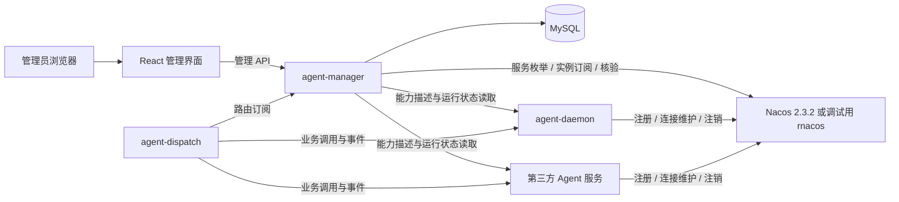
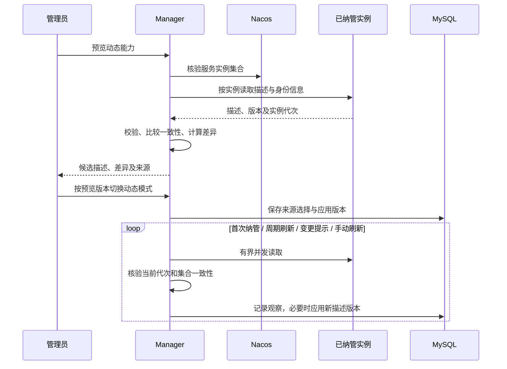

# Agent Manager 详细设计

[返回文档导航](README.md) · [架构设计](architecture.md) · [实施计划](roadmap.md)

## 1. 文档状态与设计目标

本文是 `agent-manager` 的详细设计草案，尚无实现。下文区分用户已明确的要求与本轮建议，表名、配置名和管理操作均是设计示意，不是已经冻结的 API、DDL 或标准协议。

### 1.1 已明确的要求

- Manager 后端使用 Go，使用 MySQL 管理 Agent 能力和 Agent 服务配置。
- 使用 Nacos **2.3.2** 作为服务注册发现基线；项目本地调试可以使用轻量的 rnacos。
- 提供 React 管理界面，查看服务、实例和 Agent，配置能力描述。
- 能力描述有两个来源：管理员通过界面配置；Manager 调用已注册实例的能力描述接口动态获取。
- 保留 `agent-id → agent-service-name → instance`，Manager 发布路由，Dispatch 负责实际调用与会话绑定。

### 1.2 本轮建议与待确认项

本文按以下建议展开，尚待讨论确认；调整时应同步修改相关流程，而不是把建议当作既定协议。

| 问题 | 本文建议 | 理由 |
| --- | --- | --- |
| 谁向 Nacos 注册 | Daemon、第三方服务直接注册，Manager 订阅与纳管 | 注册连接和存活状态跟随实际执行进程，避免 Manager 代注册造成错误存活判断 |
| 两种描述来源如何共存 | 每个 Agent 显式选择手工或动态模式，首版不做逐字段混合 | 来源清楚，避免更新覆盖与无法解释的合并 |
| 新服务如何进入平台 | 先显示为待纳管，管理员确认、绑定 Agent 后再启用 | 发现服务不等于授权调用 |
| 动态描述何时更新 | 切入动态模式时预览确认；之后一致且有效的刷新自动更新 | 保留动态更新价值，同时明确首次授权边界 |
| 部署与规模 | 首版单 Manager、单注册中心配置、单管理域 | 沿用现有范围，不引入 Manager 集群和多租户 |
| 管理身份 | 首版管理员、只读查看者两个角色 | 足够覆盖配置与查看，认证接入方式待选 |

## 2. 总体结构与职责



| 组件 | 负责 | 不承担 |
| --- | --- | --- |
| Manager | 服务纳管、接入策略、Agent 定义、描述来源、配置版本、实例观察、路由发布、管理鉴权与审计 | 原生会话、业务任务转发、执行环境管理 |
| MySQL | 持久管理配置、描述历史、发布版本、审计与必要观察记录 | 通过历史实例记录判断当前在线 |
| Nacos Naming | 实例注册、存活管理、查询、变更订阅 | Agent 业务定义、描述正文、平台会话、Manager 管理权限 |
| React 界面 | 展示、编辑、预览差异和操作反馈 | 直连 MySQL、Nacos 或执行实例；保存服务端凭证 |
| Agent 服务实例 | 维护自身注册，提供能力描述、协议声明、运行状态及执行接口 | 修改管理员的 Agent ID、服务绑定和启用开关 |

Manager 保留平台注册管理责任，具体实例注册与租约机制委托 Nacos。首版不再增加一套 Manager 心跳和实例租约，以免出现两套在线结论。

MySQL 是管理数据权威来源，Nacos 是注册状态来源，执行实例是自身协议支持与就绪状态来源。Manager 组合三者产生可路由视图；任何一方都不能越权覆盖另一方的数据。

Manager 使用 Nacos Naming，不使用 Nacos Config 保存 Agent 配置。若 Nacos 自身也使用 MySQL，必须与平台业务表使用独立 schema 和账户；Manager 不直接访问 Nacos 内部表。

## 3. 领域模型与配置归属

### 3.1 Agent、服务与实例

| 对象 | 标识与核心内容 | 生命周期 |
| --- | --- | --- |
| Agent 定义 | 稳定 Agent ID、展示名称、服务绑定、描述模式、调用配置、启用状态、配置版本 | 管理员创建和归档，不随实例下线删除 |
| 纳管服务 | 内部服务 ID、平台服务名、注册中心定位、纳管状态、接入策略、能力读取策略 | 可在实例上线前预配置，也可从待纳管服务确认创建 |
| 注册中心服务定位 | 注册中心配置 ID、namespace ID、group、service name | 唯一定位注册资源，不能只按 service name 合并 |
| 服务实例 | 注册定位、cluster、IP/端口、执行实例标识、启动代次、健康与就绪观察 | 随进程注册、重启与注销变化 |
| 能力描述版本 | 来源、结构版本、正文、内容摘要、来源实例集合、采集时间、应用状态 | 留存历史，失效不直接删除 |
| 路由版本 | 已应用配置版本、实例观察代次、可用性、过期时间和内容摘要 | 由 Manager 统一发布 |

首版一个服务配置一个 Agent ID，数据库对有效绑定设置唯一约束。保留后续一服务多 Agent 的演进空间，但不通过不同文案假定存在不同执行配置。

平台服务名在管理域内唯一，映射到一个明确的 Nacos 定位。跨 namespace、group 的同名服务不能被自动视作同一组实例；cluster 是实例筛选维度。

### 3.2 能力描述与协议能力分离

| 数据 | 示例 | 权威来源与用途 |
| --- | --- | --- |
| 业务能力描述 | “代码审查”、说明、标签、输入输出说明、示例、限制 | 管理员或动态描述；用于展示、搜索和人工选择 |
| 协议能力 | 协议版本、是否支持取消、流式事件、结果查询、原生状态恢复 | 实例声明，平台按协议校验；用于调用兼容判断 |
| 运行状态 | 后端就绪、是否接收新会话、是否接收已有会话的新执行 | 实例运行状态读取；用于当前准入判断 |
| 调用配置 | 默认执行参数、平台超时、必需协议能力、调用凭证引用 | 管理员配置；必须有对应标准协议或适配器支持才产生执行效果 |

业务描述可以声明“擅长代码审查”，不能据此认定具备工具权限或 `cancel` 操作。手工模式也需要获取和校验协议能力及运行状态，不能用手工填写代替服务支持。

### 3.3 服务配置范围

纳管服务建议保存：Nacos 定位与允许的 cluster、允许的地址范围、调用协议及版本要求、描述与状态读取方式、凭证引用、超时和刷新策略、管理员准入开关。

实例地址来自 Nacos，管理员不能在普通描述编辑器中写任意 URL 改变实际调用目标。服务可配置受控的读取相对路径；具体默认路径、传输和认证字段由后续标准协议确定。

## 4. Nacos 接入与服务发现

### 4.1 注册方式与身份

1. 管理员或部署人员准备 namespace、group、服务名及相应注册凭证和网络权限。
2. 实例生成本次启动代次，初始化协议接口和执行环境，再向 Nacos 注册临时实例。
3. 由 SDK 维护注册连接、重连与重注册；停止时尽力注销。不能将 Nacos 2.x 的连接管理一律描述为业务层 HTTP 心跳。
4. Manager 在配置范围内枚举服务，订阅实例变化，识别待纳管服务；预配置服务即使当前没有实例也必须继续追踪。
5. 纳管后读取必要的协议与状态信息，再形成路由候选。

Nacos 实例数据包含地址、cluster、健康、启用、权重、临时性和 metadata 等属性，可参考 [2.3.2 实例定义](https://github.com/alibaba/nacos/blob/2.3.2/api/src/main/java/com/alibaba/nacos/api/naming/pojo/Instance.java)。这些字段不能直接代替后端就绪和会话恢复状态。

需要在后续接入协议中定义平台执行实例标识与启动代次的携带方式。Nacos `instanceId` 或相同 IP/端口不足以证明重启前后的原生状态相同。Manager 读取结果必须与当前服务、实例和启动代次匹配；重启后旧描述、就绪观察与会话绑定均不能无条件沿用。

Nacos metadata 只放最小发现提示，例如平台接入标记、启动代次、描述变更提示；键名待协议设计。描述正文、密钥、聊天内容不写入 metadata。metadata 不是身份认证证据，身份还需依赖注册权限及实例接口认证。

### 4.2 服务枚举、订阅与核验

建议通过官方 `nacos-sdk-go/v2` 封装注册中心适配层，具体 SDK 版本经 Nacos 2.3.2 和选定 rnacos 版本联调后锁定，不把 SDK 版本号与服务器版本号等同。官方 SDK 提供服务枚举和实例订阅等能力，参考 [Go SDK](https://github.com/nacos-group/nacos-sdk-go)。

| 任务 | 规则 |
| --- | --- |
| 枚举服务 | 在限定 namespace/group 范围分页扫描，识别新服务；不假定实例订阅能通知所有新服务名 |
| 订阅实例 | 对已纳管服务持续订阅；待纳管服务按需要读取概要，避免无界订阅 |
| 周期核验 | 定期主动读取已纳管服务的完整实例集合，修复漏通知、断线和空列表问题 |
| 订阅重建 | 连接恢复后重新核验；旧观察不直接升级为新鲜状态 |
| 事件合并 | 每个服务串行归并，突发通知合并后重新读取，避免旧回调覆盖新核验结果 |
| 服务消失 | 保留管理定义，清空或失效实例候选，显示无实例；不删除 Agent 配置 |

SDK 的本地内存、磁盘缓存、空列表保护和故障切换行为都需要显式检查。**读取缓存成功不算本次注册中心核验成功**，重复读取旧数据不能延长路由有效期。

适配层需要区分“来自服务端的新响应”和“缓存回放”。如果选定 SDK 的查询不能证明前者，则使用直接服务端查询补充核验；2.3.2 有实例列表读取入口，参考 [InstanceController](https://github.com/alibaba/nacos/blob/2.3.2/naming/src/main/java/com/alibaba/nacos/naming/controllers/InstanceController.java)。这只证明最近观察到的注册状态，不提供强一致的端到端租约保证。

枚举失败不表示所有服务已删除；成功获得空实例集合则需要及时撤回对应的新会话候选。服务列表分页扫描不是原子快照，服务缺失需按服务重新核验，不能因单页变化删除管理数据。

### 4.3 健康与平台有效期

Manager 分别记录以下维度，不用单个“在线”覆盖所有状态：

- 注册中心：健康、未健康、已注销、观察过期、来源未知。
- 协议：已核验、版本不兼容、声明不完整、核验过期。
- 运行状态：就绪、忙碌、停止接收新会话、不可执行、未知。
- 管理状态：待纳管、已纳管、暂停准入、已归档。
- 描述状态：未配置、有效、过期、拉取失败、实例间不一致。

Nacos 管理实际注册存活；Manager 额外定义自己的**观察有效期**和**路由使用期限**，不能伪称拿到了 Nacos 对外保证的实例租约截止时间。

路由可用期限取注册观察、协议/就绪观察以及平台最大缓存期限的最早到期时间；动态描述模式还受描述有效期约束。推送撤回可以更早生效，但重新发布相同内容不能单独延长这些原始观察的有效期。该期限也不保证实例在到期前不会突然故障。

### 4.4 rnacos 调试边界

rnacos 上游说明其兼容 Nacos 客户端 HTTP 和 2.x gRPC 协议，适合本地开发，参考 [rnacos 项目](https://github.com/nacos-group/r-nacos)。这是上游兼容声明，尚不是本项目验证结果。

开发环境仅替换注册中心地址与认证配置，Manager 不依赖 rnacos 专有管理接口。实施时固定 rnacos 版本，执行同一套集成用例；发布前必须在真实 Nacos 2.3.2 上复验，覆盖认证、namespace/group、分页、临时实例、订阅、空列表、断线重连、注销和重启。

## 5. 能力描述设计

### 5.1 描述内容

业务描述建议包含：描述结构版本、简介、详细说明、能力条目、标签、输入输出说明、使用示例及限制。能力条目可具有稳定业务标识，便于比较版本；该标识不是可直接执行的工具名或协议方法。

Agent ID、绑定服务、管理员启用状态、调用凭证和协议能力不属于可被描述正文覆盖的字段。服务返回的展示名称可作为编辑建议，首版不自动覆盖管理员维护的 Agent 名称。

正文采用受限结构化数据。未知结构版本拒绝应用；限制字段长度、条目数、总响应体积及嵌套深度。React 展示文本或经清理的 Markdown，不执行描述里的 HTML、脚本或指令。

### 5.2 手工模式

管理员在 Agent 页面编辑描述，服务端校验后保存新的手工版本，并触发配置发布。实例上线、下线和动态采集均不能覆盖手工正文。

可以主动拉取动态描述用于预览或复制到编辑器；复制后保存的内容归属手工版本，不继续跟踪源实例。手工描述不设自动过期，但不绕过实例、协议和运行状态校验。

### 5.3 动态模式



Manager 直接读取已纳管实例，而非经随机负载均衡地址获取单个结果。首次采用动态模式前必须已有可用候选；预览记录描述摘要、实例集合和配置版本，确认时校验它们仍然有效，变化后要求重新预览。

读取操作要求只读、幂等且不触发真实 Agent 执行。描述接口的路径、认证、响应结构、条件读取支持和错误格式将在[标准协议设计](protocol-design.md)阶段确定；本文只规定 Manager 所需的语义。

### 5.4 多实例一致性与滚动更新

一个服务的对外业务能力应当一致，首版采用保守规则：

1. 以最新注册视图中健康、启用且通过身份核验的服务实例为核验集合；暂时忙碌不能成为绕过描述检查的理由。
2. 对描述做规范化后计算摘要，忽略采集时间等非业务字段；不把数组无条件排序，具体字段语义后续明确。
3. 集合内所有实例都取得新鲜、同摘要的描述，才形成新的服务级动态描述。单实例服务自然满足此条件。
4. 某个实例超时、结果过期或内容不同，均不能用“先返回者”“多数票”或随机结果替代一致性检查。
5. 新实例完成检查前不接收新会话；已验证描述不同的实例立即退出新会话候选。
6. 描述发生分歧时保留最后一致的描述并提示冲突；只有描述仍新鲜且匹配该版本的实例可继续接收新会话。首次同步未成功时不开放动态 Agent。
7. 所有实例切换为相同新描述后，再自动应用新版本。若旧版本实例已消失而新版本尚未形成完整一致结果，可以出现短暂无候选窗口。

自动更新仅作用于业务描述；不自动扩大协议权限、不修改 Agent 绑定或开启被管理员禁用的 Agent。若服务需要同时提供不同能力，应注册不同服务，而不是依靠 Manager 拼接出所有实例能力的并集。

协议能力单独按实例校验。滚动升级期间，新会话只能进入满足 Agent 必需协议能力和已采用兼容契约的实例；已有会话仍按原实例绑定处理，不能因为描述变化迁移。

### 5.5 刷新、失败和来源切换

| 场景 | 处理 |
| --- | --- |
| 内容没有变化 | 更新成功观察时间，不生成重复业务描述版本；必要时刷新路由有效期限 |
| 拉取失败但上次结果仍新鲜 | 保留上次正文与候选资格，显示最近失败，不伪造成功时间 |
| 上次结果已过期 | 保留正文供查看，标记过期；该实例退出动态 Agent 的新会话候选 |
| 首次拉取失败 | 保持未就绪，不自动退回手工模式 |
| 实例下线或代次变化后旧请求返回 | 丢弃应用结果，可记录诊断；不能恢复旧实例 |
| 编辑配置时旧拉取返回 | 校验来源模式、服务绑定和配置版本，不满足则不应用 |
| 动态切换到手工 | 预填当前描述，管理员确认后生成独立手工版本；保留动态历史 |
| 手工切换到动态 | 预览差异，验证一致性，确认后切换；旧手工版本保留 |
| 描述结构不兼容或格式错误 | 保存失败原因，不替换最后有效描述，不反复无上限重试 |

自动刷新采用超时、有界并发、指数退避与抖动，同一服务合并重复触发。实例变化、描述提示变化可提前调度，但不能凭提示摘要直接信任描述。手动刷新返回任务状态，不长时间占用管理请求连接。

已有会话的原生上下文不随描述更新而恢复或改变。单纯描述过期、分歧不等于已有任务失败；是否允许新的会话内执行应依据实例可达、协议/就绪状态及 Agent 准入策略，查询和取消通道另行保留。

## 6. MySQL 持久化设计

### 6.1 建议逻辑表

以下是建表前的逻辑模型，不冻结 SQL 类型和字段拼写。

| 表 | 核心内容 | 关键约束 |
| --- | --- | --- |
| `managed_services` | 平台服务名、Nacos 定位、cluster 筛选、纳管状态、地址策略、读取策略、凭证引用、版本 | 平台服务名唯一；注册中心配置 + namespace + group + service 唯一 |
| `agents` | Agent ID、名称、绑定服务、描述模式、当前描述版本、调用配置、启用状态、版本、归档信息 | Agent ID 唯一且归档后不复用；首版有效服务绑定唯一 |
| `capability_revisions` | 手工/动态来源、结构版本、正文、摘要、服务及来源配置版本、创建者与时间 | 版本内容不可变；同服务同语义内容可复用但来源观察分开记录 |
| `capability_observations` | 实例标识及代次、描述版本、最近成功/尝试时间、失败原因、一致性状态 | 以服务、实例和代次关联，不能让旧观察覆盖新代次 |
| `instance_observations` | 最近地址、Nacos 属性、协议/就绪观察、来源和有效期 | 仅供诊断与重建核验目标，不是启动时在线依据 |
| `route_publications` | 持久单调版本、已应用管理版本、完整快照、摘要、观察代次、有效期、发布时间 | 版本唯一，已发布内容不可变；版本与快照同事务提交 |
| `control_state` | 当前管理变更序号、发布目标序号、当前已发布路由版本 | 单行协调首版发布，写入配置时持久记录发布需求 |
| `audit_events` | 操作者、资源、动作、前后版本、结果、请求关联、时间 | 追加写入，敏感值脱敏 |

认证方式确定后再决定是否需要用户、角色和登录会话表；不提前强制引入独立身份系统。注册中心连接和数据库连接属于部署配置；MySQL 保存服务对注册中心的定位，不把数据库自身连接密钥放进业务表。

正文和协议扩展可使用受校验的 JSON，身份、状态、关系、版本和检索字段使用独立列。时间统一按 UTC 存储，索引覆盖服务定位、Agent 绑定、实例代次、观察有效期与审计查询。

### 6.2 修改、并发与历史

- 配置写入携带预期版本，冲突时返回最新版本和可比较内容，避免多人编辑静默覆盖。
- 同一事务保存配置、版本递增、审计及持久发布需求。配置保存成功不等于 Dispatch 已应用。
- 动态应用也使用版本条件：服务绑定、描述来源或管理员配置已变化时，旧后台任务不得写入。
- 描述回滚产生新配置版本并引用历史正文，不能倒退配置或路由序号；动态模式回滚若不改变来源策略，会被后续刷新替换，应先切手工或停用自动应用。
- 有 Agent 绑定的服务不能直接删除；先禁用和解除绑定或归档。注销 Nacos 实例不删除平台配置，平台归档也不替执行进程注销。
- 历史描述、审计和发布快照按可配置保留策略清理，仍被当前配置或保留快照引用的描述不得提前删除。

首版不依赖 MySQL 与 Nacos 的分布式事务。纳管和平台暂停仅改变 MySQL 中的平台策略；Nacos 注册由实例维护。界面明确区分“平台停止新调用”和“在注册中心注销”。

## 7. 路由生成、发布与故障恢复

### 7.1 候选选择

新会话候选必须同时满足：

```text
Agent 已启用且未归档
AND 服务已纳管且允许准入
AND Nacos 最新有效观察中实例 healthy、enabled 且 weight > 0
AND 实例身份、启动代次与地址策略通过校验
AND 协议版本兼容并满足 Agent 必需操作
AND 运行状态新鲜且允许接收新会话
AND 动态模式下实例描述新鲜且匹配已采用的业务描述版本
```

忙碌、停止新会话、停止新执行与完全不可达分别表达。路由保留必要的已知实例身份、地址与状态，区分“新会话候选”和“已有绑定的操作目标”；退出候选集合不意味着查询、取消或现有执行应被强制中断。

### 7.2 发布内容与过程

完整路由视图包括 Agent 定义与配置版本、描述版本、服务定位、实例标识/代次/地址、协议支持、运行状态、新会话候选、不可用原因、观察有效期限和路由版本。仅向有权限的 Dispatch 暴露必要信息；调用凭证分发方式待认证设计，不把密钥放进普通配置响应。

首版使用单个发布协调器：

1. 配置事务记录管理变更序号；实例、描述或状态变化唤醒协调器，定时重建负责补偿。
2. 读取一致的已提交管理配置和按服务串行归并后的观察集合，记录配置序号及观察代次。
3. 生成完整候选快照；提交前检查输入是否仍有效，变化则重新构建，禁止跨版本拼接。
4. MySQL 事务锁定 `control_state` 并再次校验管理序号，同事务写入快照、递增持久路由序号并推进已应用的管理序号。观察归并与本次提交由协调器串行处理，提交期间到达的观察随后触发下一轮发布。
5. 提交后通知 Dispatch。通知失败可重发，Dispatch 通过版本检查和完整重拉补齐，不依赖内存事件恰好送达。

即使正文摘要不变，延长有效期限也要有真实的新观察并发布新版本。描述刷新失败、重启重放和重复回调均不能单独续期。

发布器必须在快照到期前调度续期或失效处理。若 MySQL 不可写而无法提交撤回，旧路由依靠既有有效期自然停止新调用；管理界面报告发布失败，不能宣称禁用已全局生效。

### 7.3 Dispatch 消费边界

建议完整快照配合变更通知；具体传输、路径、编码及确认机制由标准协议设计决定。必须满足：

- 首次同步成功后才能接受业务调用；重连、版本缺口或校验失败时重新拉取完整视图。
- 原子替换本地快照，旧版本不能覆盖新版本；Manager 重启不重置序号。
- 到达使用期限后，即使没有收到撤回通知也停止新增调用；不自行延长观察期限。
- Agent 禁用后拒绝新的业务执行，正在执行的任务不自动取消；查询与取消按权限和实例状态继续处理。
- 已有会话按持久实例及代次绑定，服务改绑不将已有会话悄悄送往新服务；不具备恢复证明时重启实例也视为不可恢复。
- 展示“配置已保存”“路由已发布”；没有 Dispatch 确认机制时，不能显示“所有 Dispatch 已生效”。

禁用、改绑和下线存在传播窗口。最大陈旧时间、时钟偏差处理和已有会话的新执行策略必须在协议冻结前定稿；首版建议以服务端截止时间配合本地单调倒计时，按允许时钟误差保守缩短，禁止客户端反复获取旧快照重置计时。

### 7.4 依赖故障

| 故障 | Manager 行为 | 对调用的影响 |
| --- | --- | --- |
| Nacos 不可达 | 显示观察降级，停止刷新注册有效期，持续退避核验 | 有效期内可用旧候选；过期停止新准入，不把失联当作进程已退出 |
| MySQL 不可读/写 | 不确认新配置，不生成无法持久化的新路由；已加载管理视图只供降级查看 | Dispatch 受既有快照有效期约束，不承诺继续更新路由 |
| 描述接口失败 | 保留最后正文与失败信息，按模式和有效期控制候选 | 手工描述不受正文读取失败影响；动态模式按实例过期剔除 |
| 就绪接口失败 | 不延长就绪观察 | 过期实例停止接收新调用，实际执行结果仍需查询核验 |
| Manager 重启 | 恢复持久管理配置与发布序号，重新核验注册和运行状态 | 旧快照在原期限内使用；历史观察不自动续期 |
| Manager 与实例网络不通 | 区分 Nacos 存活和接口不可达 | 不宣称 Agent 已退出；过期后停止新准入 |

Manager 不接管结果未知的任务，也不因注册状态变化重放执行。

## 8. React 管理界面

### 8.1 页面与操作

| 页面 | 展示与操作 |
| --- | --- |
| 概览 | 已纳管/待纳管服务数、Agent 启用数、可用实例数、描述异常、Nacos/MySQL 与发布状态 |
| 服务发现 | 按 namespace/group/service 筛选；显示发现来源、实例概要，执行纳管或忽略；零实例预配置服务也能查看 |
| 服务详情 | 注册定位、cluster 与地址策略、实例列表、读取策略、认证引用、协议差异、暂停准入 |
| Agent 列表 | Agent ID、展示名称、绑定服务、描述模式、启用状态、可用性、保存及发布版本 |
| Agent 编辑 | 基本信息、手工描述编辑器、动态预览、差异比较、来源切换、调用配置与启用控制 |
| 能力历史 | 手工/动态版本、内容差异、来源实例、采集结果、应用时间和回滚到手工版本 |
| 诊断与审计 | 配置操作、刷新任务、实例冲突、失败原因、路由发布进度与关联版本 |

前端建议采用 React + TypeScript，页面路由、表格/表单和服务端状态库在实施时选定，首版不在设计阶段锁定额外 UI 框架。

### 8.2 关键交互

- 新建 Agent：选择已纳管服务 → 配置描述来源 → 校验 → 保存为禁用状态 → 明确启用。
- 动态模式显示来源服务、实例核验覆盖、正文版本、最近成功时间、有效期限和最近错误；“刷新成功”不能只代表任务已提交。
- 模式切换、服务改绑、禁用和归档显示实际影响；服务改绑提示已有会话仍留在原实例。
- 配置保存后显示待发布、已发布或发布失败及版本；发布失败允许重试，不要求再次覆盖保存配置。
- 动态正文只读；需要编辑时切换手工模式，不能编辑后又被刷新覆盖。
- 编辑冲突展示服务端新版本，允许比较后重新提交；后台刷新不能重置未保存的表单。
- 无实例、接口失败、描述过期和多实例冲突提供不同原因，不只显示笼统的“离线”。

首版前端可用有界轮询刷新列表和任务状态，不要求管理页面长连接。开发时前端开发服务器代理管理 API；交付时建议由 Manager 提供构建后的静态文件，实现同源访问。构建产物的嵌入方式在实现时确定。

## 9. 管理操作与标准协议边界

本节定义后台必须支持的管理操作，**不固定 API 路径和消息字段**。

| 操作组 | 必要操作 |
| --- | --- |
| 服务 | 分页发现、读取详情、纳管、预配置、修改策略、暂停准入、归档 |
| 实例 | 列表、详情、注册/协议/就绪观察、失败原因、手动重新核验 |
| Agent | 分页查询、创建、详情、版本条件更新、启停、改绑、归档 |
| 描述 | 手工保存、动态预览、切换来源、提交刷新、查询刷新状态、历史及差异 |
| 发布 | 当前目标/已发布版本、失败原因、重试发布、订阅方状态（后续有确认机制时） |
| 运维 | 管理认证、权限检查、依赖健康与审计查询 |

接口设计要求：列表有分页和稳定排序；写入携带预期版本；创建和任务提交可识别重复请求；耗时读取以有界后台任务处理；刷新任务状态可先存内存，Manager 重启后明确报告状态丢失并允许重新刷新，不能伪造完成结果。结构错误、权限不足、版本冲突、依赖不可用、描述不一致和发布失败分别表达。

后续标准协议还必须补齐：实例身份与代次、描述结构及版本、协议能力声明、就绪及接收新任务状态、读取认证、Nacos 注册 metadata 最小约定、路由快照与有效期语义。业务执行、流式事件、取消、会话与结果恢复继续单独设计，本文不提前选择传输或端点。

## 10. 权限与接入约束

- 管理 API 区分管理员和查看者；认证实现待选，生产部署不能默认匿名写入。写操作有审计，读取响应不返回密钥正文。
- 实例直连 Nacos 后，注册写权限由 Nacos 的账户/授权和部署网络共同限制；Manager 负责纳管与接口身份核验。前者能否细化到约定服务范围必须实测，不能假设默认就具备完整隔离。
- 注册凭证、描述读取凭证、Dispatch 调用凭证和底层 Agent 凭证分别管理。MySQL 保存受控引用；首版具体凭证载体在认证设计中确认。
- 描述读取只允许已纳管服务、受信地址范围和批准端口，禁止任意跨主机重定向；DNS 解析、连接目标与 TLS 校验必须符合策略，防止注册数据诱导 Manager 请求其他内网管理接口。
- 首版允许按部署明确配置 Agent 所在私网段，不使用“一律禁止私网”阻断正常部署；本机管理地址、云元数据地址等不在默认接入范围。
- 描述正文不改变工具权限、运行目录或执行程序；后端仍负责真实工作区和工具授权。
- 采集和管理请求均限制大小、超时、并发与频率；日志不输出凭证或完整敏感正文。

## 11. 后端组织、配置与观测

### 11.1 建议目录

以下均为计划目录，当前不创建实现或模块：

```text
cmd/agent-manager/             # 组装依赖和启动
internal/manager/domain/       # Agent、服务、描述和状态规则
internal/manager/application/  # 管理操作、采集协调与发布
internal/manager/store/mysql/  # 数据访问与事务
internal/manager/registry/     # 注册中心接口与观察模型
internal/manager/registry/nacos/
internal/manager/capability/   # 能力读取、校验和版本比较
internal/manager/routing/      # 快照构建与发布
internal/manager/http/         # 管理 API 与静态文件
internal/manager/auth/         # 认证、授权与凭证解析
web/agent-manager/             # React 源码
migrations/                   # 平台业务库迁移
```

跨 Manager/Dispatch/Daemon 共享的协议类型在协议确认后放到 `internal/` 下的共享包，不让其他组件导入 Manager 的数据库模型。

### 11.2 配置项与建议起点

以下仅是调试起点，不是 Nacos 默认值或已验证的生产指标，实施时结合实例规模和故障检测目标调整。

| 配置 | 建议起点 |
| --- | --- |
| MySQL | DSN/密钥引用、连接池、连接与查询超时、迁移策略；具体 MySQL 版本实施前固定 |
| Nacos | 服务端列表、namespace ID、group 范围、认证、TLS 和 SDK 缓存策略 |
| 服务枚举周期 | 30 秒，分页大小 100；纳管配置变化立即补充订阅 |
| 已纳管实例主动核验 | 10 秒；订阅变更触发提前核验 |
| 注册观察最长有效期 | 30 秒，成功服务端核验才能刷新 |
| 协议/就绪读取 | 每 10 秒；最长有效期 30 秒 |
| 描述刷新 | 60 秒；最长有效期 5 分钟 |
| 单次实例读取 | 总超时 3 秒，包含连接与读取；响应体上限 256 KiB |
| 并发与退避 | 全局并发 8，同服务合并任务；退避约 1～60 秒并加抖动 |
| 路由最大缓存期限 | 30 秒，且不能超过任何参与准入的观察期限 |
| 正常配置发布目标 | 依赖正常时 3 秒内完成 Manager 发布；不等于所有 Dispatch 同时应用 |
| 前端状态轮询 | 5 秒，页面不可见时降低频率 |

注册中心网络需要覆盖所选 SDK 的 HTTP 与客户端 gRPC 通道；按实际端口映射配置，不把所有协议塞进一个 HTTP 反向代理。版本、端口和凭证配置在可运行组件交付时补充完整启动说明。

存活探针只说明 Manager 进程可响应；管理写就绪、路由发布就绪和依赖状态分别暴露。MySQL 或 Nacos 故障不应让健康页面伪装成所有 Agent 已退出。

核心观测包括：枚举/订阅/核验延迟与失败、缓存来源、观察过期数、描述一致性与刷新耗时、任务队列、目标与已发布版本差距、发布失败、有效候选数和数据库耗时。审计与日志关联管理请求、Agent、服务、实例及代次、配置和路由版本，指标避免正文摘要等无界标签。

## 12. 实施顺序与验收

### 12.1 实施顺序

1. 讨论确认第 1.2 节，定稿实例身份、描述/协议/就绪读取、管理认证与路由有效期语义。
2. 初始化 Go 模块和 MySQL 迁移，实现服务与 Agent 管理、手工描述及版本审计。
3. 接入 Nacos，完成服务发现、纳管、订阅与主动核验；以 rnacos 辅助日常调试。
4. 完成动态描述采集、一致性判断、来源切换和过期控制。
5. 完成路由持久发布、重启恢复，并通过模拟 Dispatch 验证订阅语义。
6. 交付 React 管理界面，完成配置与异常诊断闭环。
7. 在真实 Nacos 2.3.2 和选定 rnacos 上分别执行集成与故障验收，再与实际 Daemon、Dispatch 联调。

### 12.2 针对性验收

| 范围 | 必须覆盖的情况 |
| --- | --- |
| 注册发现 | 多 namespace/group 同名服务不串联；分页发现；预配置零实例；上线、健康变化、权重归零、注销和服务消失 |
| 新鲜度 | SDK 旧缓存、磁盘恢复、空列表保护、订阅无变化、断线；只有真实核验可续期，到期定时失效 |
| 身份与重启 | 同地址新代次；旧请求晚返回；伪造 metadata；不能错误复用旧就绪、描述或会话 |
| 手工模式 | 实例刷新不覆盖正文；协议/就绪未核验时不能凭手工描述准入 |
| 动态模式 | 首次失败、内容不变、非法结构、超大正文、部分实例失败、分歧、滚动升级和全部过期 |
| 配置并发 | 两人编辑、切换来源时采集返回、服务改绑时旧结果返回、回滚与动态刷新竞争 |
| 发布恢复 | 保存后崩溃、提交后通知失败、版本缺口、旧通知、发布失败、期限缩短与续期、Manager 重启 |
| 路由边界 | 首次未同步不可用；禁用阻止新执行；暂停新会话不终止已有任务；已有会话不改绑或自动迁移 |
| 安全与界面 | 未授权操作、密钥脱敏、受控私网、恶意重定向、描述渲染、表单冲突、刷新失败和发布失败提示 |
| 中间件兼容 | Nacos 2.3.2 与固定 rnacos 分别跑完整注册/发现/认证/恢复场景，不以其一替代另一方证明 |

后端使用 Go 单元测试、真实 MySQL/注册中心集成测试及必要的 `go test -race ./...`；前端验证构建、类型检查和关键浏览器操作。模拟实例可验证 Manager 状态处理，但不能替代实际 Agent 执行和原生会话恢复测试。

本次交付只修改设计文档，尚未运行 Go、React、MySQL、Nacos 或 rnacos，也不宣称已有兼容性、性能或端到端证明。

## 13. 下一轮需要定稿的问题

1. 确认实例直连 Nacos、描述模式二选一、先纳管再启用三项建议。
2. 确认动态模式自动应用一致刷新，以及描述过期/分歧时停止对应实例的新会话准入；是否需要可选人工审批。
3. 确定描述结构、协议声明与就绪状态的最小读取契约，及实例标识/启动代次的认证关联方式。
4. 确定首版管理认证、注册凭证发放、实例读取和 Dispatch 调用认证；明确 Nacos 实际授权粒度。
5. 固定 MySQL、Go SDK、rnacos 版本，确认时间参数、时钟偏差和发布传播目标。

以上问题不改变已明确的 Go + MySQL + Nacos 2.3.2 + React 技术方向；协议端点与执行消息仍按[标准协议设计范围](protocol-design.md)另行设计。
