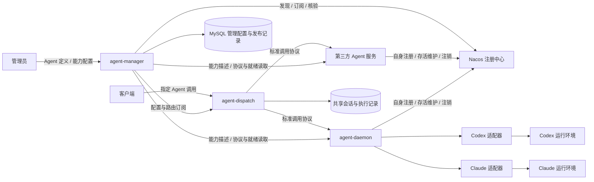

# 架构设计

[返回文档导航](README.md) · [项目介绍](../README.md)

本文记录 Agent Hub 的组件职责、核心概念、主要流程及状态归属，作为后续协议和实现设计的基础。当前尚无服务实现，具体字段、接口和运行参数仍待设计。

Manager 本轮确定采用 MySQL、Nacos 2.3.2 和 React 管理界面，开发调试可使用 rnacos。下文注册流程按“实例直连 Nacos、Manager 订阅纳管”的建议方案更新，尚待确认；设计状态与备选问题见 [Manager 详细设计](agent-manager-design.md)。

## 1. 核心概念

| 概念 | 含义 |
| --- | --- |
| Agent Definition | 面向客户端的逻辑 Agent，具有稳定的 `agent-id`，绑定一个服务 |
| Agent Service | 一组提供相同调用契约和能力的实例，以 `agent-service-name` 标识 |
| Service Instance | 实际接受 Dispatch 调用的服务实例，具有独立实例身份、启动代次、地址与协议版本，由 Nacos 管理注册存活 |
| Agent Daemon | 平台提供的 Agent 服务实现，包装现成 Agent 并管理执行过程 |
| Backend Adapter | Daemon 内部连接某种现成 Agent、转换请求与执行事件的适配器 |
| Capability Description | 管理员配置或由 Manager 从服务实例动态获取的业务能力说明，例如代码审查、文档生成 |
| Protocol Capabilities | 服务声明的实际协议支持项，例如流式事件、取消和会话恢复 |
| Platform Session | 平台面向用户维护的一次持续交互，关联 Agent、执行实例及工作区 |
| Native Session | 由 Daemon 或第三方服务管理的底层 Agent 会话和执行上下文 |
| Execution | 会话中的一次任务执行，具有可追踪的状态与结果 |
| Workspace | 执行使用的目录、文件及相关运行环境 |

调用关系为：

```text
agent-id → agent-service-name → 可用实例集合 → 本次会话绑定的实例
```

Agent、服务和实例分开建模。实例重启不删除 Agent 定义和平台历史记录，但历史记录保留不代表原生会话或工作区已经恢复。

首版允许一个服务注册多个实例，先按一个服务配置一个 Agent ID 使用；保留一个服务关联多个 Agent ID 的扩展空间。若引入多个执行配置，需明确 Agent ID 与服务端执行配置的绑定，不能仅用不同能力描述假定存在不同执行行为。

同一服务下的实例应提供一致的调用契约和对外能力，使新会话可以分配给任一兼容实例。已有会话是否可迁移，需要额外的状态恢复能力。

## 2. 整体架构



### 2.1 三个程序的职责

| 程序 | 职责 | 架构边界 |
| --- | --- | --- |
| `agent-manager` | Nacos 服务发现与纳管、平台接入策略、实例观察有效期、Agent 定义、能力与调用配置、路由发布、React 管理界面 | 管理数据的权威来源，实例注册存活委托 Nacos，不参与每次业务请求的转发 |
| `agent-dispatch` | 订阅并缓存路由、客户端鉴权、服务选择、会话绑定、调用与事件转发、平台记录 | 面向标准协议调用服务；正常请求使用本地路由，不逐次查询 Manager |
| `agent-daemon` | 提供标准服务接口、注册自身、封装现成 Agent、维护原生会话、管理执行环境与资源、转换执行事件 | 直接接受 Dispatch 调用；厂商差异封装在内部适配器中 |

Daemon 本身就是可被路由的 Agent 服务实例。Daemon 内部可以管理多个会话、执行任务或子进程，具体进程组织方式后续确定。

### 2.2 第三方服务接入

第三方服务可以用任意语言实现平台标准协议，自行维护 Nacos 注册、连接与执行状态，接受 Dispatch 直接调用，无需额外部署 Daemon。

Dispatch 对 Daemon 和第三方服务采用一致的发现、鉴权、路由与调用规则，不依赖具体 Agent 品牌或内部实现。平台后续可以提供接入库或 SDK，减少服务实现注册与协议处理的成本。

第三方服务也需要符合平台的会话、状态和故障语义，不能只实现一个聊天接口就被假定具备完整接入能力。

### 2.3 程序组织与部署

计划在同一个 Go 仓库中构建以下入口，共享协议类型和必要基础库，当前尚未创建对应代码：

```text
cmd/
  agent-manager/
  agent-dispatch/
  agent-daemon/
```

首版 Manager 单实例部署；Dispatch 从设计上支持多实例，通过共享持久化存储协调平台会话、实例绑定及执行记录。管理数据与对话数据可以使用同一数据库的不同表，不要求部署两个数据库。

Daemon 部署在能够运行底层 Agent 并访问相应工作区的环境中，负责与底层 Agent 的程序化交互，不依赖模拟人工操作交互式终端。具体使用何种子进程接口、SDK 或连接方式，在适配器设计阶段确定。

服务实例需要访问 Nacos；Manager 需要访问 Nacos、MySQL 及实例的描述与状态接口，Dispatch 需要访问 Manager 和服务注册地址。存在 NAT 或无法直连的网络时，应另行设计反向连接或任务拉取模式。Manager 数据库确定使用 MySQL；具体通信方式及 Go 框架暂不固定。

## 3. 主要流程

### 3.1 服务注册与在线状态

1. 管理员准备 Nacos 注册范围与凭证，并在 Manager 配置允许纳管的服务身份与地址范围。
2. Daemon 初始化自身服务及后端执行环境；第三方服务完成自身初始化。
3. 服务向 Nacos 注册自身实例，由 SDK 维护注册连接和恢复；必要的实例标识与启动代次约定后续设计。
4. Manager 发现并纳管服务，核验注册状态、实例身份、协议支持及就绪状态，按配置从实例读取动态能力描述。
5. 服务正常停止时向 Nacos 注销；注册健康、就绪或观察有效期不满足要求时，实例退出新会话的可选集合。
6. 服务重启后使用新启动代次重新注册；旧观察和晚返回的旧请求不能恢复新实例的可用状态。

Nacos 管理注册存活，Manager 管理平台观察和路由有效期，首版不再维护另一套实例心跳。Nacos 健康状态不等于拥有一个可直接交给 Dispatch 的端到端租约保证。

必须区分服务进程存活、注册观察有效、后端可执行和能够接受新任务。Daemon 自身存活不代表底层 Agent、凭证、工作区和执行资源均已就绪；繁忙或停止接收新任务也不应直接被解释为已中断现有执行。

服务上报不能覆盖管理员维护的 Agent 定义、手工能力描述和启用状态；仅在明确选择动态来源时，描述刷新按一致性与版本规则更新正文。

### 3.2 Agent 与能力配置

Manager 维护 Agent ID、服务绑定、展示信息、业务能力描述、调用参数和启用状态。

业务描述支持界面手工配置和从服务实例动态读取两种来源；首版建议每个 Agent 显式选择其一，切换时预览差异。多实例一致性、刷新失败和过期规则见 [Manager 详细设计](agent-manager-design.md)。

业务能力描述用于展示和检索；服务实际支持的协议操作由服务声明并由平台校验。修改描述不会自动增加工具权限、模型能力、取消能力或会话迁移能力。

配置修改产生新版本并触发路由更新。每次执行记录实际使用的配置版本、路由版本及实例，便于解释历史行为。若某项配置会改变服务端行为，需要另行定义配置传递和生效机制。

禁用 Agent 后，Dispatch 在收到变更后拒绝新的业务执行，既有任务的处理策略后续明确。禁用不等于终止底层进程；取消或查询既有任务也不能与发起新执行混为一谈。

### 3.3 Dispatch 订阅与路由

Dispatch 需要同步完整调用信息，包括 Agent 定义、服务绑定、调用配置、实例身份与启动代次、地址、协议支持项、就绪状态、观察有效期限和路由版本，不能只订阅 Agent ID。

首版可采用完整路由快照配合版本变更通知；具体订阅协议后续设计。架构上要求：

- 本地路由视图保持一致，避免不同版本的配置与实例信息混用。
- 覆盖初次同步、增删改、断线重连和漏通知后的恢复。
- Manager 重启后版本仍能衔接，旧更新不能覆盖新视图。
- Dispatch 首次同步完成前不接受业务调用。
- Manager 短暂失联时，仅在路由允许的陈旧时间及观察有效期限内继续使用缓存，不能自行延长期限或把旧缓存当作新核验。

配置、禁用和下线存在传播窗口，需要在协议设计时确定延迟目标及失联策略，不承诺所有 Dispatch 立即同时生效。

新会话从可用实例中分配；已有会话按持久化绑定路由。实例不可用时，不能因另一个实例健康就忽略会话归属切换执行。

### 3.4 对话与任务执行

1. 客户端查看可访问的 Agent 及能力说明，明确选择 Agent ID。
2. Dispatch 为新会话选择兼容实例，建立平台会话与实例、工作区的绑定；服务管理对应的原生会话。
3. 客户端提交任务，Dispatch 校验权限、配置和绑定，记录执行并调用服务。
4. Daemon 通过适配器驱动底层 Agent；第三方服务按自身实现执行。
5. 服务返回执行事件与结果，Dispatch 转发并保存平台所需记录。
6. 后续交互继续进入该会话绑定的实例，由服务延续原生上下文。

平台会话与原生会话通过受控关联维护，客户端无需依赖厂商原生标识。展示用聊天历史不能被假定为完整执行上下文，也不能在恢复原生会话时无条件重复注入历史。

首版按会话绑定实例与工作区，不提供跨实例自动迁移。原实例不可用时明确报告会话不可用；进程重启后的恢复也必须核验原生状态和工作区，不能只依赖平台历史记录。

平台共享存储协调跨 Dispatch 的会话绑定、重复请求和并发限制；实际执行服务也需要维护自身执行状态。首版同一会话同一时间只允许一个任务执行。

### 3.5 故障与恢复原则

- 路由无效、实例不可用、协议能力不匹配及执行失败需要能够区分。
- 连接断开或请求超时不能直接证明 Agent 已停止，客户端断开是否取消任务需要单独约定。
- 不自动切换实例重放结果未知的任务，避免重复执行工具或修改文件。
- 取消请求被接受与实际执行已经停止需要分别表达，取消不能保证撤销既有副作用。
- 重复提交的识别需要 Dispatch 与实际执行服务共同约定，不承诺“恰好执行一次”。
- Dispatch 异常恢复不能误判其他实例仍在处理的任务；服务侧可能仍在执行，需要结果核验。
- Manager 恢复后重新核验 Nacos 注册和实例状态，不能把历史观察记录直接当作在线实例。

## 4. 数据、执行资源与权限

| 数据或资源 | 责任方 |
| --- | --- |
| 服务纳管、平台接入策略、实例观察、Agent 配置与路由版本 | Manager，持久管理数据存入 MySQL |
| 实例注册、注册连接、存活检测与注销 | Nacos 及服务自身 SDK；注册权限由 Nacos 与部署策略约束 |
| 用户会话归属、Agent 绑定、执行实例映射、展示记录与调用记录 | Dispatch 使用共享存储管理 |
| 原生会话、底层进程或连接、实际执行状态和执行配置 | Daemon 或第三方服务 |
| 工作目录、文件、执行凭证与资源配额 | 实际执行服务所在环境 |

平台历史记录、原生会话和工作区具有不同的恢复与保留要求，分别设计持久化和清理策略。共享聊天存储不代表任一实例都能恢复其他实例的任务。

Daemon 管理自身执行所需的进程或连接生命周期、并发额度、超时、退出清理和工作区边界；底层 Agent 的安装、升级及机器级运维策略另行讨论。

不同会话能否共享工作区必须明确配置，避免共享文件状态造成意外干扰。客户端不能直接指定任意可执行程序、启动参数或文件系统路径；执行配置与工作区访问应由服务按授权解析。

Manager 校验管理者、服务和 Dispatch 的权限；Dispatch 校验客户端、Agent 调用权限及会话归属；执行服务落实运行环境与工具权限。注册凭证、服务调用凭证与底层 Agent 凭证分别管理，密钥不进入普通响应、聊天历史或日志。

运行观测覆盖实例及后端就绪状态、路由同步、配置传播、执行耗时、并发、错误和结果未知状态。记录应能关联 Agent、会话、执行与实例，默认避免输出完整敏感内容。

## 5. 后续设计

Manager 的存储、发现、能力来源、React 页面及发布方案见 [Manager 详细设计](agent-manager-design.md)。具体协议的设计范围见[标准协议设计范围](protocol-design.md)，首版交付和验收方向见[首版范围与实施计划](roadmap.md)。
